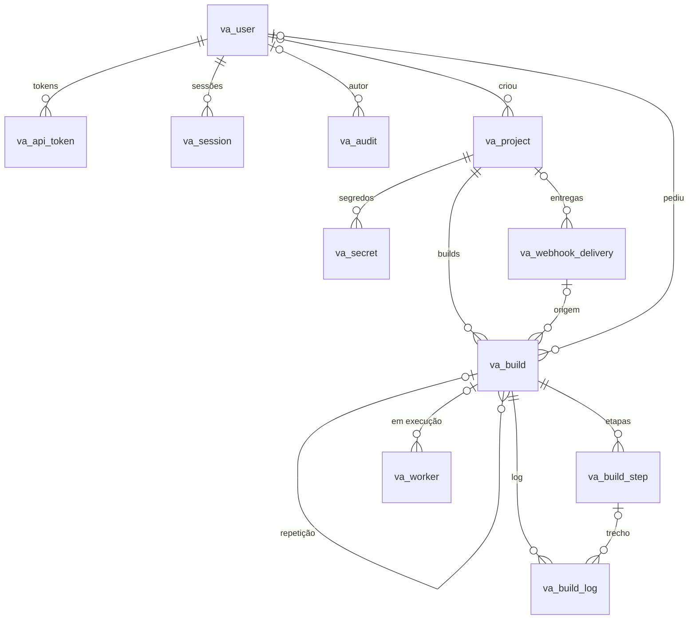

# Banco de dados do Vau

Resumo da estrutura. O documento completo, com todas as colunas, tipos, regras, índices, decisões de arquitetura e backup, está em [`Banco-de-Dados-Vau.pdf`](Banco-de-Dados-Vau.pdf).

## Onde cada dado fica

| Lugar | Conteúdo |
|---|---|
| Banco relacional (`VAU_DATABASE_URL`) | Usuários, sessões, tokens, projetos, segredos cifrados, entregas de webhook, builds, etapas, logs, workers, auditoria e limite de taxa |
| `storage/.chave` ou `VAU_APP_KEY` | Chave de 32 bytes que cifra os segredos (libsodium secretbox) |
| `storage/logs/vau.log` | Log técnico em JSON Lines |
| Volumes Docker `vau-b<ID>` | Código clonado durante um build; removidos no fim |

Convenções: tabelas com prefixo `va_`, datas em UTC (`Y-m-d H:i:s`), booleanos 0/1, segredos no formato `v1:` + base64(nonce + texto cifrado).

## Diagrama

`va_rate_limit` e `va_schema_migration` não têm relacionamentos.

## Tabelas

| Tabela | Função |
|---|---|
| `va_user` | Contas do painel, perfil (admin, operador, leitor) e bloqueio por tentativas |
| `va_api_token` | Tokens da API (só o SHA-256) |
| `va_session` | Sessões do painel |
| `va_project` | Repositório, gatilhos, filtros, limites do container, deploy e avisos |
| `va_secret` | Variáveis secretas cifradas, com opção "somente deploy" |
| `va_webhook_delivery` | Toda chamada recebida em `/webhook`, aceita ou recusada |
| `va_build` | Builds e fila (`queued` → `running` → `success`, `failed`, `error` ou `canceled`) |
| `va_build_step` | Etapas de cada build (clone, steps e deploy) |
| `va_build_log` | Log em trechos, com segredos mascarados |
| `va_worker` | Workers conectados e batimento |
| `va_audit` | Trilha de auditoria |
| `va_rate_limit` | Contadores do limite de taxa |
| `va_schema_migration` | Migrações aplicadas |

## DDL

Gerado com `php bin/vau schema:dump <driver>`:

- [`schema-sqlite.sql`](schema-sqlite.sql)
- [`schema-mysql.sql`](schema-mysql.sql) (MySQL 8+ e MariaDB 10.6+)
- [`schema-postgresql.sql`](schema-postgresql.sql) (PostgreSQL 13+)

O Vau cria e atualiza as tabelas sozinho na primeira conexão (`VAU_AUTO_MIGRATE=true`) ou com `php bin/vau migrate`.
